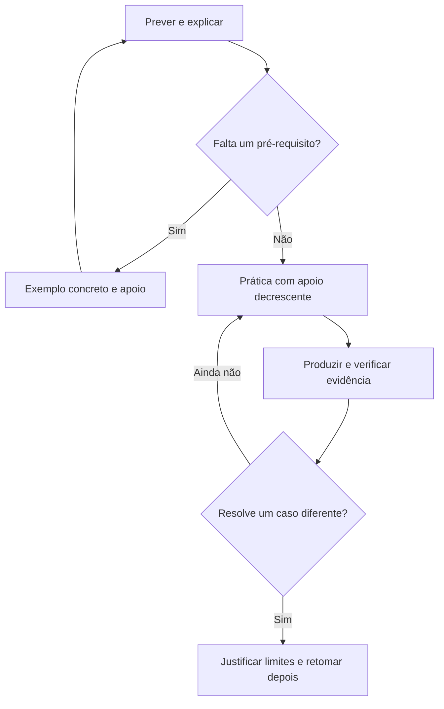

# Começar sem presumir formação prévia

A comparação com uma IA sem treinamento será usada como metáfora de instruções explícitas e progressivas. O diagnóstico deve identificar o que você já consegue fazer, sem presumir experiência em computação e sem apagar suas experiências anteriores.

## Primeira tarefa

No papel: uma quantidade começa em 2, recebe 3 e depois perde 1. Registre cada estado e explique a mudança. Se essa representação ainda não fizer sentido, use objetos ou marcas e peça apoio. Não existe penalidade por precisar do exemplo.

## Trilha inicial com aulas prontas para tentar

| Ordem | Habilidade | Aula | Evidência da tentativa |
|---|---|---|---|
| 1 | Representar valores | [Variáveis](../unidades/primeiros-passos/01-variaveis.md) | Tabela antes/depois e explicação |
| 2 | Decidir por uma condição | [Decisões](../unidades/primeiros-passos/02-decisoes.md) | Casos abaixo, igual e acima do limite |
| 3 | Repetir com estado | [Repetição](../unidades/primeiros-passos/03-repeticao.md) | Traçado, lista vazia e contagem |
| 4 | Decompor e integrar | [Decomposição](../unidades/primeiros-passos/04-decomposicao.md) | Partes, contratos e testes de integração |
| 5 | Aplicar e justificar | [Missão M01](../missoes/m01.md) | Solução, teste e decisão com limites |

As aulas são propostas iniciais, sem avaliação de eficácia com aprendizes. As demais unidades do catálogo ainda são roteiros que exigem exemplo e revisão específicos. Não é necessário executar todos os itens do catálogo em sequência: use os pré-requisitos e o problema de interesse para compor o percurso.

## Ciclo de aprendizagem

Descrição textual do ciclo: uma dificuldade leva ao apoio adequado; a tentativa seguinte reduz o apoio; evidências e um caso diferente determinam o que precisa ser retomado. Nenhum caminho autoriza declarar domínio apenas por ter visto a solução.

[Registro de progresso](progresso.md) · [Base pedagógica](../pedagogia/fundamentos.md)
