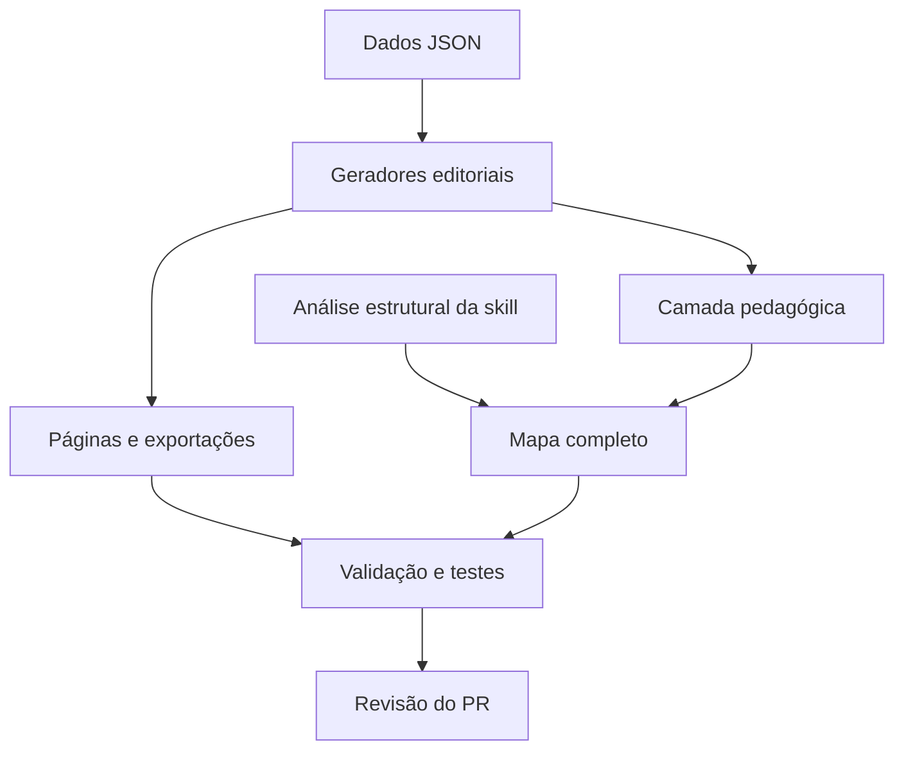

# Estrutura do repositório

O repositório tem duas dimensões conectadas: **o que aprender** (currículo, habilidades, fontes e missões) e **como manter isso verificável** (dados, geradores, validadores, testes e CI). O mapa completo da skill Understand Anything liga arquivos, símbolos e componentes. A numeração local e os vínculos bibliográficos continuam propostas editoriais.

## Onde trabalhar

| Área | Fonte editável e finalidade | Resultado ou uso |
|---|---|---|
| Dados curriculares | `data/disciplinas.json`, `eixos.json`, `cursos.json`, `fontes.json` | Catálogos em curriculo/, disciplinas/ e matrizes/ |
| Habilidades | `data/indices-disciplinas.json`, `indices-cursos.json`, `habilidades.json`, `perfis-habilidades.json` | Unidades por disciplina e curso; itens com origem e cobertura |
| Fontes e pesquisa | `data/referencias.json`, `relacoes-fontes.json`, `funcoes-fontes.json` | Bibliografia por disciplina, função e fonte; limitações e sugestões |
| Prática e evidências | `data/missoes.json`, `trilha-inicial.json`; aulas em unidades/primeiros-passos/ | Tentativa, explicação, transferência e julgamento; sem progresso inventado |
| Fundamentos | pedagogia/ e `data/base-pedagogica.json` | Fundamentação e limites de leitura; avaliação científica pendente |
| Produção editorial | scripts/gerar.py, relacoes.py, aprendizagem.py, mapa.py | Geração determinística de páginas, exportações e mapa composto |
| Validação e consulta | scripts/validar.py e trilhar.py | Integridade estrutural e consulta somente leitura |
| Laboratório e testes | laboratorio/referencia.py e tests/ | Exemplos de referência e testes; não são evidência de desempenho humano |
| Governança | README, CONTRIBUTING, AGENTS, agentes/, docs/, templates/ e licenças | Regras de autoria, revisão, curadoria, tutoria e contribuição |
| Integração contínua | .github/workflows/validar.yml | Regenera, valida, testa e detecta diferenças nos arquivos gerados |

Os diretórios existentes foram preservados para manter links e histórico. Não é necessário mover aulas para compreender suas relações: o grafo e o índice de arquivos acrescentam navegação sobre a estrutura atual.

## Fluxo de manutenção

1. Edite os JSON de data/ ou uma aula original. Use os templates e identifique o estado editorial.
2. Execute `python3 scripts/gerar.py`: ele chama os renderizadores e compõe os mapas.
3. Execute `python3 scripts/validar.py` e `python3 -m unittest discover -s tests -v`.
4. Ao alterar arquitetura ou conteúdo, execute a skill `$understand --full --language pt-BR --no-auto-update`. A reconstrução completa evita tratar a composição pedagógica como snapshot estrutural. Preserve a exportação pedagógica e use o procedimento abaixo para recompor os mapas após a análise.
5. Abra PR ligado à issue e descreva validação estrutural, limites científicos e revisão humana separadamente.

## Mapas e artefatos

- `.ua/structural-graph.json`: snapshot da análise de arquivos, símbolos, imports, relações documentais, camadas e tour de manutenção.
- `.ua/pedagogical-graph.json`: exportação determinística das habilidades e suas relações, com tour de prática próprio.
- `.ua/knowledge-graph.json`: composição exibida pelo visualizador oficial, com conexões entre documentos e itens pedagógicos. Seu tour principal ensina a manutenção.
- `.ua/fingerprints.json` e `.ua/meta.json`: baseline criado pelos scripts oficiais da skill após a validação.
- `.ua/analysis.json`: cobertura, método, verificações, avisos e limites da execução. Os hashes permitem reconhecer alterações posteriores.
- `.ua/intermediate/scan-result.json`: inventário oficial preservado para análise incremental; os outros intermediários e arquivos temporários são locais.

Após uma nova execução da pipeline, o resultado estrutural de `.ua/knowledge-graph.json` deve ser preservado como `.ua/structural-graph.json` **antes** de executar o gerador editorial. Se o resultado já contiver os nós pedagógicos, não o copie como snapshot estrutural: isso duplicaria os itens. O compositor valida unicidade e referências. A análise desta integração registra uma base Git e hashes dos arquivos do espaço de trabalho; esses hashes, e não a suposição de um checkout imutável, delimitam o conteúdo observado.

Para abrir o visualizador, siga o [guia local](mapa-aprendizagem.md). Escolha camadas arquiteturais para entender manutenção e camadas dos eixos para estudar habilidades. Os arquivos de entrada podem ser consultados sem o painel; o [índice de arquivos](indice-arquivos.md) oferece uma alternativa textual.

## Escopo e limites

A análise cobre os arquivos do projeto incluídos pelo scanner oficial, incluindo testes e documentação gerada. Os próprios artefatos da análise em .ua/ são excluídos para evitar recursão; arquivos ignorados pelo Git, progresso privado e dependências externas não fazem parte do inventário. Uma relação `imports` deriva do resolvedor oficial; uma relação `documents` indica menção ou ligação local, não suporte científico. Resumos e camadas são interpretações assistidas por IA, sujeitas a revisão.

A identificação de uma função não comprova seu comportamento em todos os casos. Testes verificam cenários explícitos; a análise não substitui execução, revisão de segurança ou avaliação pedagógica. Arquivos gerados são observados como artefatos locais, sem alegar leitura integral dos livros e cursos vinculados. Hooks, publicação de progresso pessoal, chamadas pagas e atualização automática não foram habilitados.
