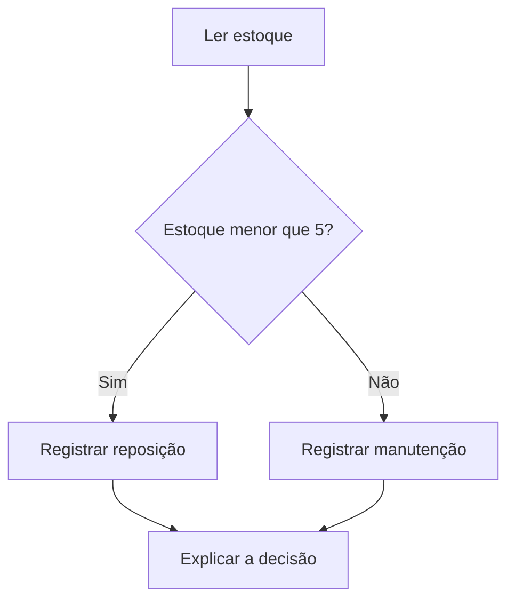

# 2. Escolher um caminho por uma condição

Unidade U-PRG01-02. Aula autoral inicial; revisão pendente. Pré-requisito: representar valores.

## Prever e representar

Queremos mostrar “repor” se um estoque tiver menos de 5 peças. Antes de ler a resposta, preveja o resultado para estoques 4, 5 e 6.

| Estoque | estoque < 5 | Mensagem |
|---|---|---|
| 4 | verdadeiro | repor |
| 5 | falso | manter |
| 6 | falso | manter |

Descrição textual: apenas valores estritamente menores que 5 ativam a reposição. O caso 5 é uma fronteira importante.



## Exemplo guiado

```python
estoque = 4
if estoque < 5:
    print("repor")
else:
    print("manter")
```

`if` inicia uma decisão; `else` apresenta a alternativa. As linhas recuadas pertencem ao respectivo caminho. Execute apenas depois de prever. Compare a tabela com o fluxo.

## Prática e evidência

Com apoio: mude o limite para 8. Independente: escreva uma regra “alerta” para consumo simulado maior ou igual a 12. Teste 11, 12 e 13 e explique por que usar `>=` em vez de `>`.

## Transferência e julgamento

Relacione a condição à [lógica e matemática discreta](../../disciplinas/mat02.md) e à decisão de um circuito digital, sem montar hardware. Discuta uma consequência de configurar um limite inadequado. Essa decisão simples não é um controlador real certificado.

Registre previsão, solução, testes e apoio recebido; retome com outro limite posteriormente.

[Próxima aula: repetição](03-repeticao.md) · [Progresso](../../aprendizagem/progresso.md)
